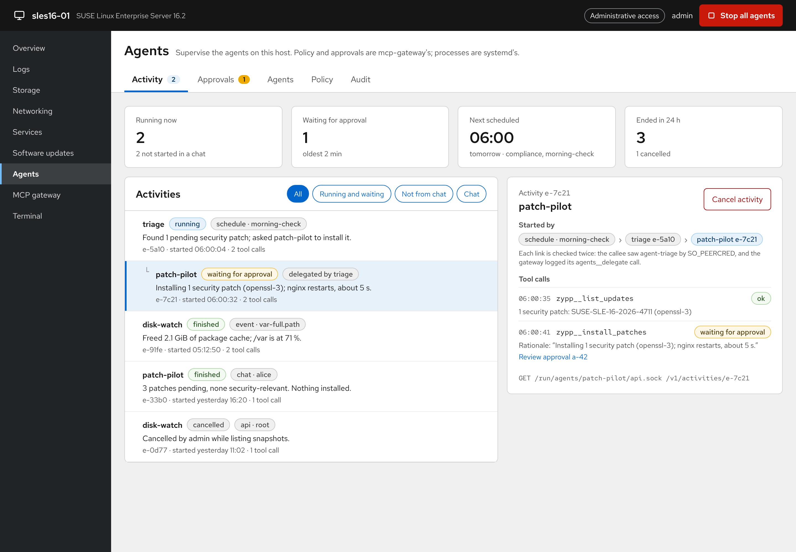
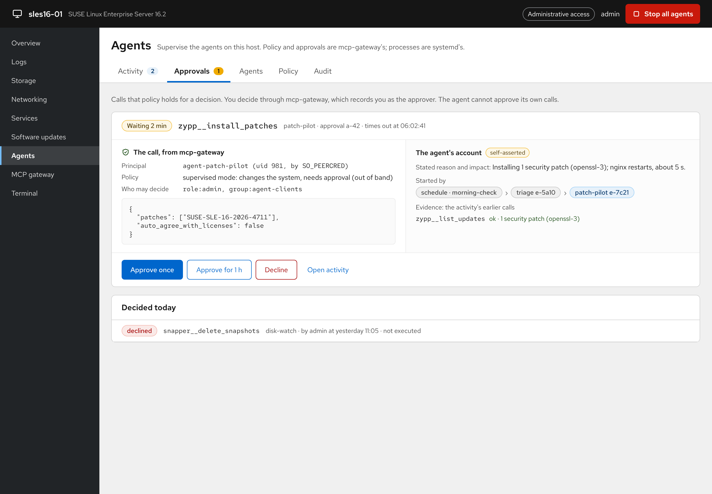

# cockpit-agentic

A governed agentic control plane for SUSE Linux Enterprise Server 16 and
openSUSE Leap 16. Agents run on the host. Administrators see what they
do, approve what needs approval, review what was done, and step in when
needed, all from Cockpit.



*Mockup of the Cockpit control plane (design, not yet implemented as a
Cockpit page). Source: [`docs/mockup/Main.dc.html`](docs/mockup/Main.dc.html).*

## How it works

Each agent is its own process: a Google ADK agent, run by systemd as its
own system user (`agent@<name>.service`). Nothing central runs the
agents. Enforcement is in the operating system and in
[mcp-gateway](https://github.com/sdrahn/mcp-gateway):

| Concern | Enforced by |
|---|---|
| What an agent may do (tool boundaries, autonomy mode) | mcp-gateway's OPA policy, for the principal `agent-<name>` |
| Human-in-the-loop approval of state-changing calls | mcp-gateway's approval broker; the agent cannot approve its own calls |
| What the agent process can touch | systemd sandbox and the SELinux domain `agent_t` |
| Emergency stop | the gateway denies every agent everything, and systemd stops every agent |
| Audit trail | journald: the agents' records next to the gateway's |

**Autonomy modes**, enforced by the gateway:
- **advisory:** reads only.
- **supervised (default):** every change needs an approval.
- **bounded:** changes marked autonomous may run without one.

Agents are started by people (chat over AG-UI or the ADK REST API), by
schedules (systemd timers), by events, or by other agents. Delegation
goes through the gateway, where it is governed and traceable.



## The contract

[CONTRACT.md](CONTRACT.md) is the interface between the parts. **Part
I** is what any Cockpit control plane consumes:
- discovery;
- activities, with origin and delegation trace;
- the control API on `/run/agents/<name>/api.sock`;
- autonomy modes;
- approvals;
- intervention;
- the journal fields;
- AG-UI.

None of it is specific to ADK, kit or any other agent host. **Part II**
is the reference implementation in this repository. **Part III** maps
the SLES 16.2 control-plane requirement to the contract and lists the
open items.

## Repository layout

| Path | Contents |
|---|---|
| `cmd/agent-launcher` | the host: runs one ADK agent on its systemd socket; also `trigger` for schedules |
| `cmd/agent-delegate` | the gateway's `agents` MCP server, for delegation between agents |
| `cmd/agent-admin` | administration: create, modes, permissions, pause, emergency stop |
| `internal/governance` | ADK plugin: activities, local limits, journal records, approval notices, delegation trace |
| `internal/agui` | the AG-UI endpoint |
| `internal/launcher` | assembles an agent; the control API; end-to-end tests |
| `internal/openai` | ADK model for OpenAI-compatible servers (on-premises, air-gapped) |
| `internal/gateway`, `internal/peercred`, `internal/journal`, `internal/config`, `internal/admin` | gateway connection, caller identity, journald, `agent.yaml`, `agent-admin` |
| `gateway/policy` | the autonomy modes as a Rego module for mcp-gateway, with tests |
| `gateway/servers.d` | the `agents` server definition |
| `systemd/` | `agent@.service`, `agent@.socket`, `agent-schedule@.service`, `agent-schedule@.timer` |
| `selinux/` | the `cockpit_agentic` module |
| `packaging/` | OBS packaging for SLES 16.0/16.1 and Leap 16.0/16.1 (`suse/`), sysusers.d, tmpfiles.d |
| `examples/patch-pilot` | an example agent and its gateway permissions |
| `docs/` | the mockup and its screenshots |

## Development

Requirements: Go ≥ 1.25. For the policy tests: `opa` and a checkout of
mcp-gateway.

```bash
make build                     # bin/agent-launcher, bin/agent-admin, bin/agent-delegate
make check                     # gofmt, go vet, go test (incl. the end-to-end approval flow)
make policy-test GATEWAY_POLICY=../mcp-gateway/policy
```

The end-to-end tests run a whole agent against a scripted model and a
fake gateway, so they need no network and no model.

Run an agent from a checkout:

```bash
go run ./cmd/agent-launcher serve --config examples/patch-pilot --listen /tmp/pp.sock --idle-exit 0
curl --unix-socket /tmp/pp.sock http://agent/v1/status
```

## Status

| Part | State |
|---|---|
| Contract (Parts I–III) | draft 1 |
| Launcher, governance plugin, AG-UI, control API, `agent-admin` | implemented, unit- and end-to-end-tested |
| Autonomy-mode policy | implemented, tested against mcp-gateway's policy with OPA 1.22 |
| Delegation bridge | implemented; not yet tested against a running gateway |
| systemd units | written, `systemd-analyze verify` clean |
| SELinux module | written, not yet built or run on SLES 16 / Leap 16 |
| OBS packaging | spec and services written; first OBS build to do |
| Cockpit page | designed (mockup); to do |

See [packaging/suse/README.md](packaging/suse/README.md) for building on OBS.
